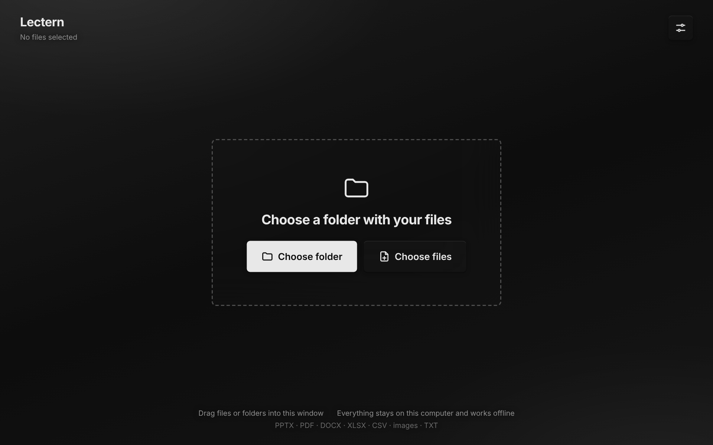
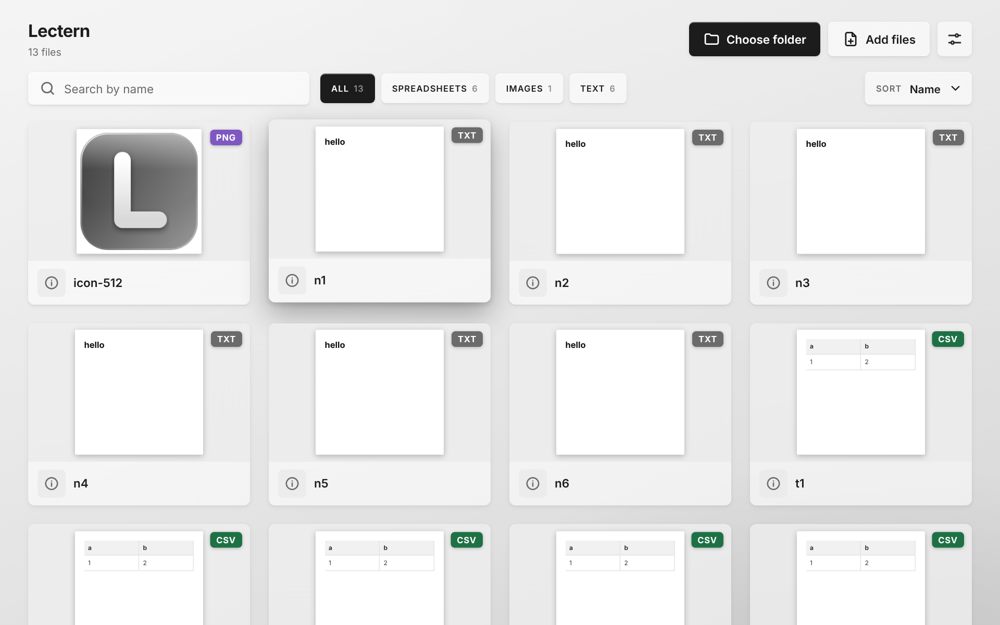
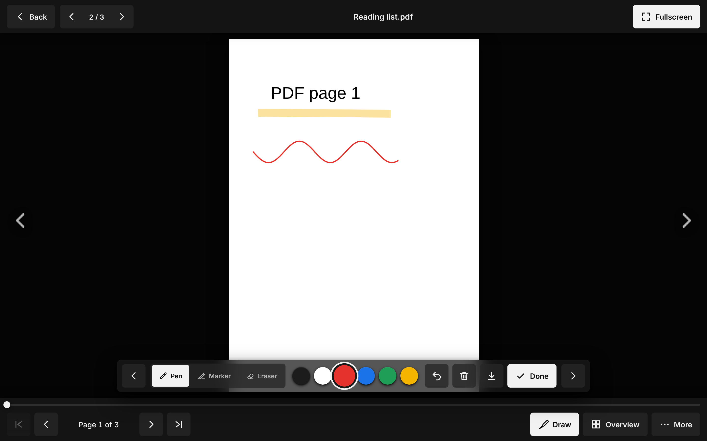
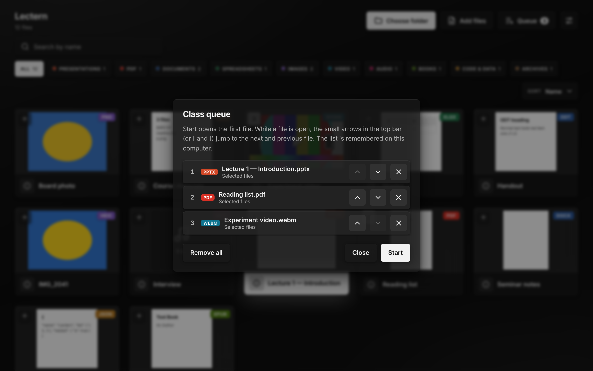

<div align="center">


# Lectern

**A calm, offline file viewer for the classroom.**<br>
Open presentations, PDFs, documents, spreadsheets, photos, video and more straight from a flash drive, or install it as an app. Nothing to set up. Nothing leaves the computer.

<br>

<a href="https://github.com/Mea6ea6/Lectern/raw/main/downloads/Lectern-v1.12.3.zip"></a>
&nbsp;
<a href="https://lectern-wheat.vercel.app"></a>

<sub>Unzip, copy the <code>Lectern</code> folder to a flash drive, double-click <code>Lectern.html</code>. The zip also has <code>HOW-TO-USE.txt</code>.</sub>

<br><br>

 

 

</div>

<br>

## Why Lectern

A lecture hall computer is a locked-down machine with whatever office software happens to be installed. Lectern is one HTML file and a folder. It works on any modern browser, with no installation, no account and no internet.

- **Plug in, double-click, present.** Run `Lectern.html` from a flash drive.
- **One viewer for everything.** Presentations, PDF, documents, spreadsheets, photos (including iPhone HEIC), video, audio, books, archives, text.
- **Read-only by design.** You can't accidentally change a student's file.
- **Private.** Files are read locally in the browser and never uploaded anywhere.
- **Built for touch boards.** Large targets, swipe, an immersive full-screen mode, pen and marker.

## Features

| | |
|---|---|
| **Library** | Thumbnails, search, type filters (the Filter button), sorting, details on <kbd>Space</kbd> |
| **Presentations** | Slide viewer, keyboard and touch navigation, overview, full screen |
| **PDF and documents** | Zoom (buttons, two-finger pinch, double tap, trackpad pinch), drag a zoomed page, fit to page or width, rotate, overview |
| **Pen and marker** | Draw over any page or slide: pen, see-through marker, eraser, a thickness slider (a circle around the pointer shows the real line width), colours, an eraser that rubs out only the part you touch, undo / redo, save as picture; the bar can be dragged and the page gets the whole screen. The file is never changed |
| **Class queue** | Pick the files for a lesson, put them in order, flip through them one after another. Cleared when the page reloads or another folder is opened |
| **Bookmarks** | Mark pages (<kbd>M</kbd>), see them on the progress bar and in the overview, jump with <kbd>,</kbd> <kbd>.</kbd> |
| **Laser pointer** | A red dot that follows the mouse or a finger (<kbd>L</kbd>); nothing is drawn on the page |
| **Timer** | Silent timer (<kbd>T</kbd>): countdown, or count up to a set time. The readout sits quietly in the top bar and in the file list header, and turns red when the time is reached |
| **Speaker notes** | PPTX and ODP notes in a side panel (<kbd>N</kbd>) |
| **Presenter view** | Two windows: slides on the projector, a companion window on your laptop with your speech (any file) plus a panel with the current and next slide, the notes and a shared timer (<kbd>P</kbd>). Slides turn from either window (More → Stop presenter view ends it); pen, laser and black screen stay in the presentation window. Works offline, for PDF and PowerPoint |
| **Fullscreen window** | More (top right) → Fullscreen window hides the browser's bars on any screen (Esc leaves) |
| **Hints** | Small designed tooltips with key hints appear when you pause over a button |
| **Video and audio** | A deliberately tiny player: play / pause and 5 seconds back / forward |
| **Themes** | Light and dark with a frosted-glass look |
| **Swiss style** | Black and white only, Inter typeface, shadows instead of outlines |
| **Installable PWA** | Works offline after the first load, opens files from the OS |
| **Drag and drop** | Drop files or whole folders into the window |

## Quick start

### From a flash drive

1. Download **[Lectern-v1.12.3.zip](https://github.com/Mea6ea6/Lectern/raw/main/downloads/Lectern-v1.12.3.zip)** and unzip it.
2. Copy the `Lectern` folder to the drive and put your files into `Files/`.
3. Double-click **`Lectern.html`** and press **Choose folder**.

More detail (browsers, Firefox's "upload" question, all shortcuts) is in `HOW-TO-USE.txt` inside the zip.

### In the browser or as an installed app

Open **<https://lectern-wheat.vercel.app>**. In Chrome or Edge use **Install** in the top bar: after that Lectern starts offline and can be chosen in *Open with…* for supported files.

## Keyboard shortcuts

| Key | Action |
|---|---|
| <kbd>/</kbd> | Search |
| <kbd>←</kbd> <kbd>→</kbd> <kbd>↑</kbd> <kbd>↓</kbd> | Select a file, turn pages |
| <kbd>Enter</kbd> | Open the selected file |
| <kbd>Space</kbd> | Show file details |
| <kbd>Q</kbd> | Add the selected file to the class queue |
| <kbd>Esc</kbd> | Close or go back |

### In the viewer

| Key | Action |
|---|---|
| <kbd>→</kbd> <kbd>Space</kbd> / <kbd>←</kbd> | Next / previous page (video and audio: 5 seconds; <kbd>Space</kbd> plays or pauses) |
| <kbd>D</kbd> | Pen and marker on / off (<kbd>1</kbd> pen, <kbd>2</kbd> marker, <kbd>3</kbd> eraser, <kbd>Ctrl</kbd>+<kbd>Z</kbd> undo, <kbd>Ctrl</kbd>+<kbd>Shift</kbd>+<kbd>Z</kbd> redo) |
| <kbd>[</kbd> <kbd>]</kbd> | Previous / next file of the class queue |
| <kbd>M</kbd> / <kbd>,</kbd> <kbd>.</kbd> | Bookmark this page / previous, next bookmark |
| <kbd>N</kbd> | Speaker notes (PPTX, ODP) |
| <kbd>P</kbd> | Presenter view: opens the companion window (in the companion: <kbd>↑</kbd> <kbd>↓</kbd> or <kbd>Page Up</kbd> <kbd>Page Down</kbd> turn the slides, <kbd>←</kbd> <kbd>→</kbd> turn this window's own file) |
| <kbd>L</kbd> | Laser pointer on / off |
| <kbd>T</kbd> | Timer |
| <kbd>G</kbd> / <kbd>F</kbd> | Overview / full screen |
| <kbd>B</kbd> <kbd>W</kbd> | Black / white screen |

## Supported formats

| Type | Extensions |
|---|---|
| Presentations | `pptx`, `ppsx`, `pptm`, `ppsm`, `potx`, `odp` |
| PDF | `pdf` |
| Documents | `docx`, `odt`, `rtf` |
| Spreadsheets | `xlsx`, `xls`, `csv`, `tsv`, `ods` |
| Images | `png`, `jpg`, `gif`, `webp`, `bmp`, `svg`, `avif`, `apng`, `ico`, `tiff`, `heic` |
| Video | `mp4`, `m4v`, `webm`, `mov`, `ogv`, `mkv` (if the browser knows its codec) |
| Audio | `mp3`, `wav`, `ogg`, `m4a`, `aac`, `flac`, `opus` |
| Books | `epub` |
| Text | `txt`, `md`, `log` |
| Code and data | `json`, `html` (shown as text, never run) |
| Archives | `zip` (lists the contents, nothing is unpacked) |

Video and audio play what the browser can play (MP4/H.264 and WebM are fine in Chrome, Edge and Safari). Old `.ppt` / `.doc` are not supported. ODF, RTF and EPUB are drawn by Lectern's own compact readers: text, lists, tables and pictures are shown; charts, animations and exotic layouts are not.

## Browser support

Chrome and Edge give the best experience: they can remember a chosen folder between sessions and install the app. Firefox works too; it asks to "upload" a folder, which only means *read locally*. Lectern explains this before the prompt. Dragging a folder into the window skips the question.

A web page can't see the full path of a chosen folder, so Lectern shows the folder name and file count.

## Project structure

```
Lectern.html            entry point
app/
  app.js                application logic
  style.css             themes, glass system, layout
  fonts/  fonts.css     Inter, bundled locally
  lib/                  PDF, DOCX, PPTX, XLSX, HEIC libraries (loaded on demand)
  modules/              formats.js (ODF, RTF, zip, epub, media…) and ink.js (pen), loaded on demand
icons/                  app icons
docs/                   screenshots
downloads/              the flash-drive zip offered on the front page
HOW-TO-USE.txt          the instruction that goes into the zip
manifest.webmanifest    PWA manifest and file handlers
sw.template.js          service worker source
sw.js                   generated by make-sw.py
make-sw.py              regenerates sw.js with a fresh cache version
make-flash.py           builds the flash-drive zip (python3 make-flash.py 1.12.3 --howto)
vercel.json             hosting configuration
Files/                  your documents (not committed)
```

After changing any file, run `python3 make-sw.py` so installed copies pick up the update. For a release run `python3 make-flash.py X.Y --howto` and put the zip into `downloads/`.

## Deploying to Vercel

Lectern is static: no build step.

1. Push this repository to GitHub.
2. In Vercel choose **Add New → Project** and import the repository.
3. Set **Framework Preset** to *Other*. Leave the build command empty and the output directory at the root.
4. Deploy. `vercel.json` serves `Lectern.html` at `/`.

## Third-party software

| Library | License |
|---|---|
| [PDF.js](https://github.com/mozilla/pdf.js) | Apache-2.0 |
| [docx-preview](https://github.com/VolodymyrBaydalka/docxjs) | Apache-2.0 (modified: theme fonts, pictures behind text; section breaks, theme fonts, pictures behind text; changes are noted in the file header) |
| [pptx-preview](https://github.com/meshesha/PPTXjs) | ISC |
| [SheetJS (@e965/xlsx)](https://www.npmjs.com/package/@e965/xlsx) | Apache-2.0 |
| [JSZip](https://stuk.github.io/jszip/) | MIT (dual MIT / GPLv3, used under MIT) |
| [UTIF.js](https://github.com/photopea/UTIF.js) + [pako](https://github.com/nodeca/pako) | MIT (TIFF pictures) |
| [heic2any](https://github.com/alexcorvi/heic2any) | MIT. The bundle contains [libheif](https://github.com/strukturag/libheif) and libde265, which are LGPL-3.0 (commercial use allowed; the library is a separate, replaceable file `app/lib/heic2any.min.js`) |
| [Inter](https://rsms.me/inter/) | SIL OFL 1.1 |

## License

© 2026 Igor. All rights reserved. The licence is still to be decided.
