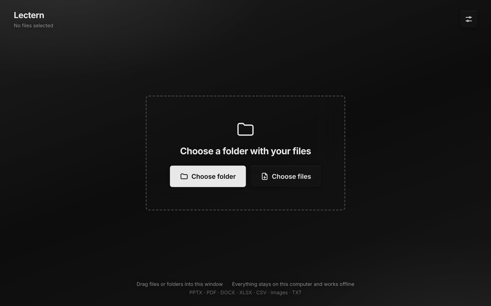
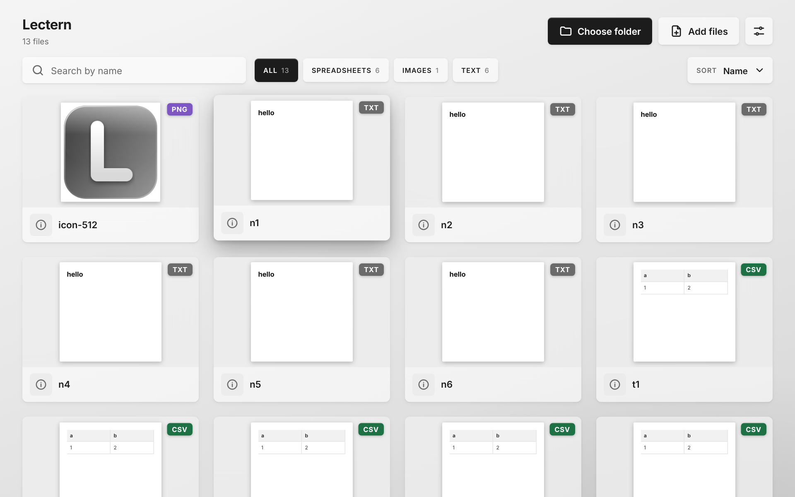
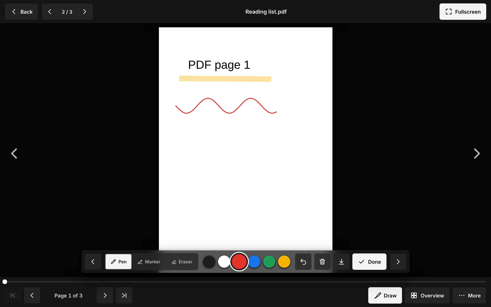
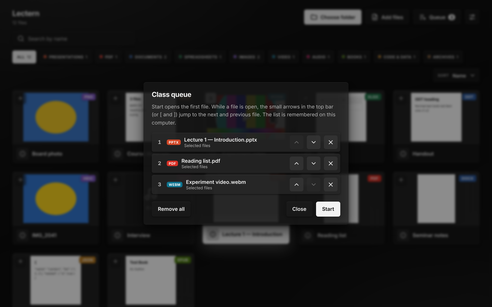

<div align="center">


# Lectern

**A calm, offline file viewer for the classroom.**<br>
Open presentations, PDFs, documents, spreadsheets, photos, video and more straight from a flash drive, or install it as an app. Nothing to set up. Nothing leaves the computer.

<br>

<a href="https://github.com/Mea6ea6/Lectern/raw/main/downloads/Lectern-v1.0.0.zip"></a>
&nbsp;
<a href="https://lectern-wheat.vercel.app"></a>

<sub>Unzip, copy the <code>Lectern</code> folder to a flash drive, double-click <code>Lectern.html</code>. The zip also has <code>HOW-TO-USE.txt</code>.</sub>

<br><br>

 

 

</div>

<br>

## Why Lectern

A lecture hall computer is a locked-down machine with whatever office software happens to be installed. Lectern is one HTML file and a folder. It works on any modern browser, with no installation, no account and no internet.

- **Plug in, double-click, present.** Run `Lectern.html` from a flash drive.
- **One viewer for everything.** Presentations, PDF, documents, spreadsheets, photos (including iPhone HEIC), video, audio, books, archives, text.
- **Read-only by design.** You can't accidentally change a student's file.
- **Private.** Files are read locally in the browser and never uploaded anywhere.
- **Built for touch boards.** Large targets, swipe, an immersive full-screen mode, pen and marker.

## Features

| | |
|---|---|
| **Library** | Thumbnails, search, type filter (the Filter button: tick several types at once, e.g. PDF and DOCX), sorting, details on <kbd>Space</kbd> |
| **Presentations** | Slide viewer, keyboard and touch navigation, overview, full screen |
| **PDF and documents** | Zoom (buttons, two-finger pinch, double tap, trackpad pinch), drag a zoomed page, fit to page or width, rotate, overview |
| **Pen and marker** | Draw over any page or slide: pen, see-through marker, eraser, a thickness slider (a circle around the pointer shows the real line width), colours, an eraser that rubs out only the part you touch, undo / redo, save as picture; the bar can be dragged and the page gets the whole screen. The file is never changed |
| **Continue where you stopped** | Every file remembers its slide / page; opening it again offers to continue from there (20 seconds to decide) |
| **Video & audio** | Volume (↑/↓, M), speed 0.25–2× (< >), time and hover time on the bar, frame step (, .), repeat, click = play/pause, double click = fullscreen |
| **Subtitles** | A .srt / .vtt with the same name next to the video is picked up automatically (C to toggle, or choose a file in More) |
| **Audio tags & cover** | Title, artist and cover art from mp3 / FLAC / M4A, on the cards and in the player |
| **Next file** | When a file ends, the next one of the same folder starts at once (video too). The queue goes first. Repeat: Off / All / One; Shuffle for music; "Play from" a folder, its subfolders or everything. The **Queue** window (next to More) lists the files and lets you drag them to change the order. <kbd>[</kbd> <kbd>]</kbd> or the arrow buttons switch files |
| **More video tools** | <kbd>J</kbd> / <kbd>L</kbd> jump 10 seconds, audio track choice (where the browser shows several). The More menu shows only what fits the file: music gets no zoom, laser or black screen |
| **Pen on video** | Pause and draw on the frame (More → Draw, or D) |
| **Queue** | Pick the files for a lesson (documents, slides, films, songs in any mix), put them in order, flip through them one after another. The number in the top bar ("2 / 5") opens the list: click a file, drag to reorder, the cross (on hover) takes a file out. A queue of different kinds is a plain list, with no playlist, shuffle or repeat. Cleared when the page reloads or another folder is opened |
| **Bookmarks** | Mark pages (<kbd>M</kbd>), see them on the progress bar and in the overview, jump with <kbd>,</kbd> <kbd>.</kbd> |
| **Laser pointer** | A red dot that follows the mouse or a finger (<kbd>L</kbd>); nothing is drawn on the page |
| **Timer** | Silent timer (<kbd>T</kbd>): countdown, or count up to a set time. The readout sits quietly in the top bar and in the file list header, and turns red when the time is reached |
| **Speaker notes** | PPTX and ODP notes in a side panel (<kbd>N</kbd>) |
| **Presenter view** | Two windows: slides on the projector, a companion window on your laptop with your speech (any file) plus a panel with the current and next slide, the notes and a shared timer (<kbd>P</kbd>). Slides turn from either window (More → Stop presenter view ends it). The companion window opens with a short note on what it is for (it can be switched off, and More → About this window brings it back); pen, laser and black screen stay in the presentation window. Works offline, for PDF, PowerPoint, video and audio: for a film or a song the panel has pause, ±5 s, previous / next, a time bar and the queue (click to play, cross to take out, foldable like the notes) |
| **Page animation** | Pages slide in a few pixels when you turn them (More → Page animation switches it off); cards slide in after a folder is chosen; respects the system's reduced-motion setting |
| **Fullscreen window** | More (top right) → Fullscreen window hides the browser's bars on any screen (Esc leaves) |
| **Hints** | Small designed tooltips with key hints appear when you pause over a button |
| **Video and audio** | A deliberately tiny player: play / pause and 5 seconds back / forward |
| **Themes** | Light and dark with a frosted-glass look |
| **Swiss style** | Black and white only, Inter typeface, shadows instead of outlines |
| **Installable PWA** | Works offline after the first load, opens files from the OS |
| **Drag and drop** | Drop files or whole folders into the window |

## Quick start

### From a flash drive

1. Download **[Lectern-v1.0.0.zip](https://github.com/Mea6ea6/Lectern/raw/main/downloads/Lectern-v1.0.0.zip)** and unzip it.
2. Copy the `Lectern` folder to the drive and put your files into `Files/`.
3. Double-click **`Lectern.html`** and press **Choose folder**.

More detail (browsers, Firefox's "upload" question, all shortcuts) is in `HOW-TO-USE.txt` inside the zip.

### In the browser or as an installed app

Open **<https://lectern-wheat.vercel.app>**. In Chrome or Edge use **Install** in the top bar: after that Lectern starts offline and can be chosen in *Open with…* for supported files.

## Keyboard shortcuts

| Key | Action |
|---|---|
| <kbd>/</kbd> | Search |
| <kbd>←</kbd> <kbd>→</kbd> <kbd>↑</kbd> <kbd>↓</kbd> | Select a file, turn pages |
| <kbd>Enter</kbd> | Open the selected file |
| <kbd>Space</kbd> | Show file details |
| <kbd>Q</kbd> | Add the selected file to the queue |
| <kbd>Esc</kbd> | Close or go back |

### In the viewer

| Key | Action |
|---|---|
| <kbd>→</kbd> <kbd>Space</kbd> / <kbd>←</kbd> | Next / previous page (video and audio: 5 seconds; <kbd>Space</kbd> plays or pauses) |
| <kbd>D</kbd> | Pen and marker on / off (<kbd>1</kbd> pen, <kbd>2</kbd> marker, <kbd>3</kbd> eraser, <kbd>Ctrl</kbd>+<kbd>Z</kbd> undo, <kbd>Ctrl</kbd>+<kbd>Shift</kbd>+<kbd>Z</kbd> redo) |
| <kbd>[</kbd> <kbd>]</kbd> | Previous / next file of the queue |
| <kbd>M</kbd> / <kbd>,</kbd> <kbd>.</kbd> | Bookmark this page / previous, next bookmark |
| <kbd>N</kbd> | Speaker notes (PPTX, ODP) |
| <kbd>P</kbd> | Presenter view: opens the companion window (in the companion: <kbd>↑</kbd> <kbd>↓</kbd> or <kbd>Page Up</kbd> <kbd>Page Down</kbd> turn the slides, <kbd>←</kbd> <kbd>→</kbd> turn this window's own file) |
| <kbd>L</kbd> | Laser pointer on / off |
| <kbd>T</kbd> | Timer |
| <kbd>G</kbd> / <kbd>F</kbd> | Overview / full screen |
| <kbd>B</kbd> <kbd>W</kbd> | Black / white screen |

## Supported formats

| Type | Extensions |
|---|---|
| Presentations | `pptx`, `ppsx`, `pptm`, `ppsm`, `potx`, `odp` |
| PDF | `pdf` |
| Documents | `docx`, `odt`, `rtf` |
| Spreadsheets | `xlsx`, `xls`, `csv`, `tsv`, `ods` |
| Images | `png`, `jpg`, `gif`, `webp`, `bmp`, `svg`, `avif`, `apng`, `ico`, `tiff`, `heic` |
| Video | `mp4`, `m4v`, `webm`, `mov`, `ogv`, `mkv` (if the browser knows its codec) |
| Audio | `mp3`, `wav`, `ogg`, `m4a`, `aac`, `flac`, `opus` |
| Books | `epub` |
| Text | `txt`, `md`, `log` |
| Code and data | `json`, `html` (shown as text, never run) |
| Archives | `zip` (lists the contents, nothing is unpacked) |

Video and audio play what the browser can play (MP4/H.264 and WebM are fine in Chrome, Edge and Safari). Old `.doc` and `.ppt` / `.pps` open as plain text (paragraphs, simple tables, slide titles and bodies — no pictures or layout; re-save as `.docx` / `.pptx` for the full look); old `.xls` opens like `.xlsx`. A file saved under the wrong extension (an RTF called `.doc`, a `.doc` called `.docx`) still opens correctly. Word and Excel files also show their charts (bar, line, area, pie, doughnut, scatter), shapes, text boxes, SmartArt and pictures; Excel keeps cell colours and column widths. Radar, bubble, doughnut, scatter, stock and surface charts work too, as do Excel formulas without a saved result (with their number formats), colour scales, data bars, icon sets and "cell is" rules; charts inside ODT/ODP files are drawn. Big sheets show 2000 rows at a time with a "Show more rows" button. 3D charts are drawn flat. ODF, RTF and EPUB are drawn by Lectern's own compact readers: text, lists, tables and pictures are shown; charts, animations and exotic layouts are not.

## Browser support

Chrome and Edge give the best experience: they can remember a chosen folder between sessions and install the app. Firefox works too; it asks to "upload" a folder, which only means *read locally*. Lectern explains this before the prompt. Dragging a folder into the window skips the question.

A web page can't see the full path of a chosen folder, so Lectern shows the folder name and file count.

## Project structure

```
Lectern.html            entry point
app/
  core.js … presenter.js  application logic (plain scripts, loaded in order: list, queue, thumbs, viewers, viewer-ui, viewer-queue, …)
  style.css             themes, glass system, layout
  fonts/  fonts.css     Inter, bundled locally
  lib/                  PDF, DOCX, PPTX, XLSX, HEIC libraries (loaded on demand)
  modules/              fmt-*.js (spreadsheets, ODF, RTF, zip, epub, media, pictures), legacy.js (old .doc/.ppt), office.js (charts, shapes, formulas), ink.js (pen), selftest.js — all loaded on demand
icons/                  app icons
docs/                   screenshots
downloads/              the flash-drive zip offered on the front page
HOW-TO-USE.txt          the instruction that goes into the zip
manifest.webmanifest    PWA manifest and file handlers
sw.template.js          service worker source
sw.js                   generated by make-sw.py
make-sw.py              regenerates sw.js with a fresh cache version
tests/                  `node tests/run.js` runs the self-check page in headless Chromium; sample files are in tests/fixtures
make-flash.py           builds the flash-drive zip (python3 make-flash.py 1.0.0 --howto)
vercel.json             hosting configuration
Files/                  your documents (not committed)
```

After changing any file, run `python3 make-sw.py` so installed copies pick up the update. For a release run `python3 make-flash.py X.Y --howto` and put the zip into `downloads/`.

## Fullscreen controls

With a mouse, the bars stay hidden in fullscreen: move the pointer to the top or bottom edge and both bars appear, they stay while the pointer is on them and go away shortly after it leaves; moving the mouse in the middle does nothing. The pointer itself hides after a moment without moving. With a finger, a tap in the middle of the page shows or hides the bars (the edges turn pages). Lectern follows whichever you used last, so a touch screen with a mouse works too.

## Touch boards

Swipes and pinches are handled by Lectern itself. A swipe that lands as two contacts (finger plus knuckle or palm) is a swipe, not a zoom: the page is zoomed only when the fingers really move apart or together. Inside the page everything inherits `touch-action: pan-y`, so the browser does not take swipes over or zoom the whole page.

## Folders and views

Files keep the folder they were in. With **Show folders** on (the folder button next to the view switch) the home screen shows one folder at a time, folders first, with a path bar above (Backspace or Alt+← goes one folder up). Turn it off for one flat list of everything. Searching always looks through all folders; the file's full path from the chosen folder is shown in its Details. Two views, remembered between launches:

- **Icons** — cards with a preview;
- **List** — one row per file: type, name, date, size;

The header (title, the search in the middle, and under it the buttons in groups with small titles: View, Arrange, Lists for the open folder on the left, and Open (Choose folder, Add files) apart on the right) stays on top, slides away while you scroll down and comes back at the first scroll up. Controls that cannot work in the current situation (for example "Keep place on the drive" without a chosen folder, or "Presenter view" for a picture) are not shown.

## Recent files

The **Recent** button (left of Queue) opens a list of the last files you opened from the folder, with the place you stopped at ("Slide 20 of 55") and when. Click a file to open it again; the cross removes it, "Clear the list" forgets them all. The list travels with the drive when "Keep place on the drive" is on.

## Keep place on the drive

By default Lectern remembers things in the browser of that computer: the page you stopped at, bookmarks, and the zoom / fit / rotation of each file. **More → Keep place on the drive** also writes them next to your files, so they travel with the flash drive:

- `Lectern-memory.json` — place in each file, bookmarks, zoom / fit / rotation, recent files, and the settings (theme, Large interface, Show tips, page-turn animation);
- `Lectern-drawings.json` — pen and marker drawings, per file and page (without the switch, drawings last only until the file is closed).

Both files are hidden from the file list. When a folder is opened, the newer entry wins. It needs Chrome or Edge and a folder chosen with **Choose folder** (the browser asks once for permission to write; after a restart it asks again when you press Reopen). Without that permission, or in Firefox/Safari, nothing breaks: everything stays on this computer. Files are written a moment after a change, so closing the tab at once may lose the last step. The drawings file keeps the last 60 drawn files. While the switch is on, a grey line under it in the menu shows the state (saved at …, needs permission with an Allow link, choose a folder first, could not write); if nothing can be written, one quiet message appears per session.

## Large interface

For a big room: **More → Large interface** makes the buttons, bars and dialogs 25% bigger (the open document itself is not touched). It is remembered between launches.

## Self-check

Open `Lectern.html#selftest` (on the flash drive, on a classroom board, in any browser). Lectern opens a small sample file of every format with the real viewers and shows what works on that device, with a "Copy report" button. The same page runs from the command line: `npm i playwright`, then `node tests/run.js`. After changing a sample file in `tests/fixtures/`, run `python3 tests/build-selftest-data.py`.

## Deploying to Vercel

Lectern is static: no build step.

1. Push this repository to GitHub.
2. In Vercel choose **Add New → Project** and import the repository.
3. Set **Framework Preset** to *Other*. Leave the build command empty and the output directory at the root.
4. Deploy. `vercel.json` serves `Lectern.html` at `/`.

## Third-party software

| Library | License |
|---|---|
| [PDF.js](https://github.com/mozilla/pdf.js) | Apache-2.0 |
| [docx-preview](https://github.com/VolodymyrBaydalka/docxjs) | Apache-2.0 (modified: theme fonts, pictures behind text; section breaks, theme fonts, pictures behind text; changes are noted in the file header) |
| [pptx-preview](https://github.com/meshesha/PPTXjs) | ISC |
| [SheetJS (@e965/xlsx)](https://www.npmjs.com/package/@e965/xlsx) | Apache-2.0 |
| [JSZip](https://stuk.github.io/jszip/) | MIT (dual MIT / GPLv3, used under MIT) |
| [UTIF.js](https://github.com/photopea/UTIF.js) + [pako](https://github.com/nodeca/pako) | MIT (TIFF pictures) |
| [heic2any](https://github.com/alexcorvi/heic2any) | MIT. The bundle contains [libheif](https://github.com/strukturag/libheif) and libde265, which are LGPL-3.0 (commercial use allowed; the library is a separate, replaceable file `app/lib/heic2any.min.js`) |
| [Inter](https://rsms.me/inter/) | SIL OFL 1.1 |

## License

© 2026 Igor. All rights reserved. The licence is still to be decided.
